# 飲料店 ERP

把點餐、原料庫存、補貨建議、供應商管理與員工權限串在一起的飲料店管理系統。顧客端提供菜單與客製化選項，管理端處理庫存、採購和規則設定，後端以 PostgreSQL 保存交易與原料資料，並整合 LINE／LIFF 和 Grafana 告警。

目前是開發與驗證中的專案。前端可以獨立建置；完整點餐、庫存扣料、LINE 身分交換與採購流程需要設定資料庫和外部服務後才能驗收。

## 目錄

- [功能與資料流程](#功能與資料流程)
- [系統架構](#系統架構)
- [環境需求](#環境需求)
- [快速開始](#快速開始)
- [設定與權限](#設定與權限)
- [目錄與介面](#目錄與介面)
- [建置與驗證](#建置與驗證)
- [部署與維護](#部署與維護)
- [常見問題](#常見問題)

## 功能與資料流程

| 功能 | 目前程式的責任 |
|---|---|
| 商品與點餐 | 管理商品、配方、客製化選項及銷售明細 |
| 原料庫存 | 記錄入庫批次、剩餘量、效期與耗用紀錄 |
| 補貨規則 | 以目標條件與依序執行的觸發動作計算補貨建議 |
| 供應商與採購 | 維護原料供應關係、採購紀錄、聲譽規則與評分 |
| 員工權限 | 支援權限代碼、角色範本、角色繼承及使用者覆寫 |
| LINE／LIFF | 接收 webhook、交換身分及提供管理入口 |
| Grafana 告警 | 接收原料相關告警並進入對應處理流程 |

補貨計算以每條規則獨立評估。優先序較高的規則優先，相同優先序取較大的建議量；規則內的目標和觸發動作依序處理。`operate`、`adjust`、`limit` 的行為以 [規則引擎](methods/restock_rules/engine.js) 和 [動作實作](methods/restock_rules/actions.js) 為準，UI 說明與後端演算法需要一起維護。

## 系統架構



架構圖的 [Mermaid 原始碼](docs/architecture.mmd) 可供後續修改。LINE 與 Grafana 是外部服務，並不會因為啟動這個倉庫就自動建立。

## 環境需求

- Node.js **20 系列至少 20.19，或 22.12 以上**；這是前端 Vite 7 鎖定套件的版本要求。建議各部分使用相同的 Node.js 版本。
- npm；根目錄與兩個前端都有獨立 `package-lock.json`。
- PostgreSQL，以及需要建立測試資料庫時使用的 `createdb`、`psql`。
- 完整登入與通知需要 LINE Channel、LIFF 設定。Grafana 告警需另外建立接收設定。

## 快速開始

以下命令從倉庫根目錄執行。先在開發環境建立自己的設定，避免直接使用範例檔中的帳密。

```powershell
npm ci
Copy-Item example.env .env
```

編輯 `.env`，至少填好資料庫、JWT 及需要使用的 LINE 設定。後端預設 port 是 `3000`，前端開發 proxy 指向 `4000`，因此本機建議明確設定：

```dotenv
SERVER_PORT=4000
SERVER_URL=http://localhost:4000
NODE_ENV=development
DATABASE_URL=127.0.0.1
DATABASE_PORT_RW=5432
DATABASE_NAME=drink_dev
DATABASE_USER=your_database_user
DATABASE_PASSWORD=replace_with_local_password
JWT_SECRET=replace_with_random_secret
```

### 建立全新的測試資料庫

`build/SQL/build.sql` 會先 `DROP TABLE ... CASCADE`，只能對可重建的空白測試資料庫執行。既有資料庫需先備份並規劃遷移，不能直接套用這份重建腳本。

```powershell
createdb -h 127.0.0.1 -p 5432 -U postgres drink_dev
psql -h 127.0.0.1 -p 5432 -U postgres -d drink_dev -v ON_ERROR_STOP=1 -f build/SQL/build.sql
```

`postgres` 是上述建立資料庫的管理帳號範例，請換成有權限的本機帳號。應用程式的帳號要另外授予對應資料表權限。範例資料放在 [build/SQL/example](build/SQL/example)，需確認適用的 schema 後再選擇匯入。

### 啟動三個部分

後端終端：

```powershell
node index.js
```

管理端終端：

```powershell
cd build/GUI/admin
npm ci
npm run dev -- --host 127.0.0.1 --port 5173
```

顧客菜單終端：

```powershell
cd build/GUI/menu
npm ci
npm run dev -- --host 127.0.0.1 --port 5174
```

後端 `http://localhost:4000/` 會回傳「伺服器運行中」。管理端與菜單分別使用 `5173`、`5174`；這個回應只代表 HTTP 服務啟動，仍需確認資料庫連線日誌及登入結果。

## 設定與權限

| 設定 | 用途與邊界 |
|---|---|
| `DATABASE_*` | 資料庫 host、port、database、帳密。此版本的 RO／RW pool 共用連線設定，不代表已部署主從資料庫 |
| `JWT_SECRET`、`LINE_ISSUE_JWT_TOKEN_SECRET` | 身分與 JWT 的設定，需依 [config/passport.js](config/passport.js) 的實際驗證方式一致配置 |
| `LINE_CHANNEL_SECRET`、`LINE_CHANNEL_ACCESS_TOKEN` | LINE webhook 驗證與訊息服務 |
| `LINE_LIFF_CHANNEL_ID`、`LINE_LIFF_URL` | LIFF 身分交換與入口 |
| `VITE_LIFF_ID` | 管理端 LIFF 初始化設定，放在管理端自己的環境檔 |
| `VITE_API_BASE`、`VITE_API_BASE_URL` | 管理端 API 設定；請依實際使用它們的模組設定，不要把 server secret 放進 `VITE_*` |
| `VITE_GRAFANA_IFRAME_SRC` | 管理端嵌入的 Grafana 來源 |

LINE 回呼網址、LIFF 網址與反向代理公開網址必須互相對應。`LIFF_DEV_TOKEN` 和 `VITE_LIFF_DEV_*` 是開發用途，不應以測試身分替代正式登入。

權限判斷由後端執行，前端隱藏按鈕只是操作提示。角色繼承、使用者覆寫與權限代碼的處理分別位於 [SQL_controller/permission.js](SQL_controller/permission.js)、[middleware/accessChecker.js](middleware/accessChecker.js) 和 [routes/permissions.js](routes/permissions.js)。

## 目錄與介面

| 路徑 | 責任 |
|---|---|
| [index.js](index.js) | Express 入口、路由掛載與啟動初始化 |
| [build/GUI/admin](build/GUI/admin) | React 管理介面與權限操作 |
| [build/GUI/menu](build/GUI/menu) | React 菜單介面 |
| [routes](routes) | 點餐、庫存、補貨、供應商、權限和外部整合 API |
| [SQL_controller](SQL_controller) | 複雜 SQL 查詢與資料存取 |
| [methods/restock_rules](methods/restock_rules) | 補貨規則的目標、動作與計算 |
| [build/SQL](build/SQL) | Schema、重建 SQL 與範例資料 |
| [corn/cleanup.js](corn/cleanup.js) | 清理排程；資料夾實際名稱是 `corn` |

主要掛載入口為 `/line`、`/liff`、`/menu`、`/inventory`、`/order`、`/autoRestock`、`/grafana`，供應商與權限路由則掛在根路徑。完整方法與請求參數以各 [routes](routes) 模組為準。

## 建置與驗證

```powershell
node --check index.js
npm --prefix build/GUI/admin run build
npm --prefix build/GUI/menu run build
npm --prefix build/GUI/admin run lint
```

建置輸出各自在前端的 `dist/`。全目錄 lint 與個別修改檔的 lint 是不同範圍，不能把局部通過當成整個專案都通過。

人工驗證至少涵蓋登入、無權限導向、角色繼承與覆寫、商品客製化、點餐扣料、庫存效期、補貨規則優先序及供應商採購。測試時使用獨立資料庫與測試 LINE Channel，確認操作前後的交易和庫存紀錄。

## 部署與維護

將兩個 `dist/` 交給靜態網站或反向代理，API 路徑要與開發 proxy 及前端 API 設定一致。LIFF 和 LINE webhook 需可由外部存取的 HTTPS 網址。

資料庫需定期備份 schema 與資料；重建 SQL 不等於無損升級工具。啟動時會清理根目錄 `cache/`，不要把需要永久保存的資料放在那裡。

資料庫程式在 production 分支有允許未驗證憑證的 SSL 設定，部署前應確認憑證與連線信任方式。`.env`、LINE token、測試身分和資料匯出都不應寫進公開文件或日誌。

## 常見問題

| 現象 | 優先檢查 |
|---|---|
| 前端一直連不到 API | `SERVER_PORT` 是否為 `4000`，或是否已同步修改兩個 Vite proxy |
| 登入後畫面沒有權限 | 後端 JWT 權限代碼、角色繼承及使用者覆寫是否一致 |
| Windows 下補貨頁空白 | `RestockRules.jsx` 應明確匯入 `./restockRules/index.jsx`，避免檔名大小寫解析到自己 |
| 補貨量與預期不同 | 規則優先序、目標命中、觸發動作順序和庫存基準 |
| HTTP 已啟動但資料讀取失敗 | 資料庫 pool 的初始化與 schema 是否完成 |
| Vite 安裝或執行失敗 | Node.js 是否符合要求，並以鎖定檔重新 `npm ci` |

這份文件以倉庫現有程式為準；沒有建立發布版、完整外部服務驗收或正式授權條款的宣稱。

## 專案倉庫

本倉庫：[Du121793/drink-shop-erp](https://github.com/Du121793/drink-shop-erp)。

## 本機私有設定

公開倉庫只提供範例設定。實際 `.env`、API token、Wi-Fi 密碼、裝置金鑰和私有設定檔保留在本機，範例占位值必須換成自己的設定才能使用相應服務。
